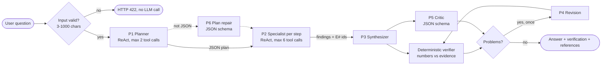
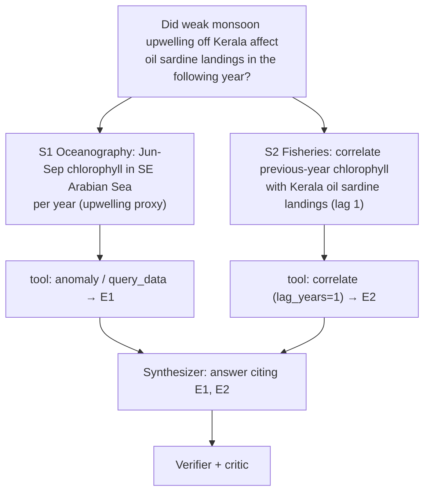
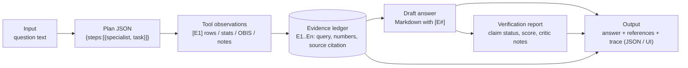
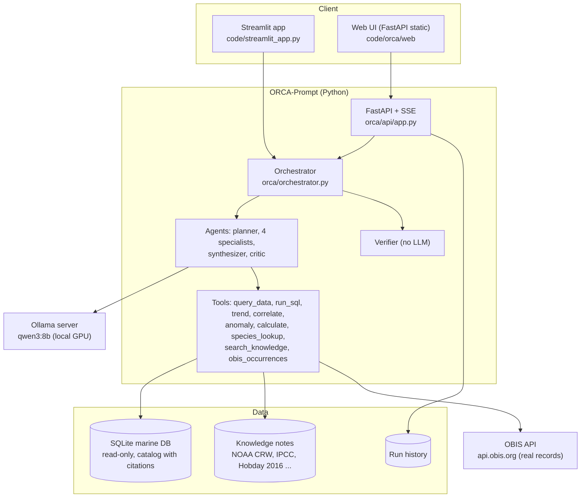
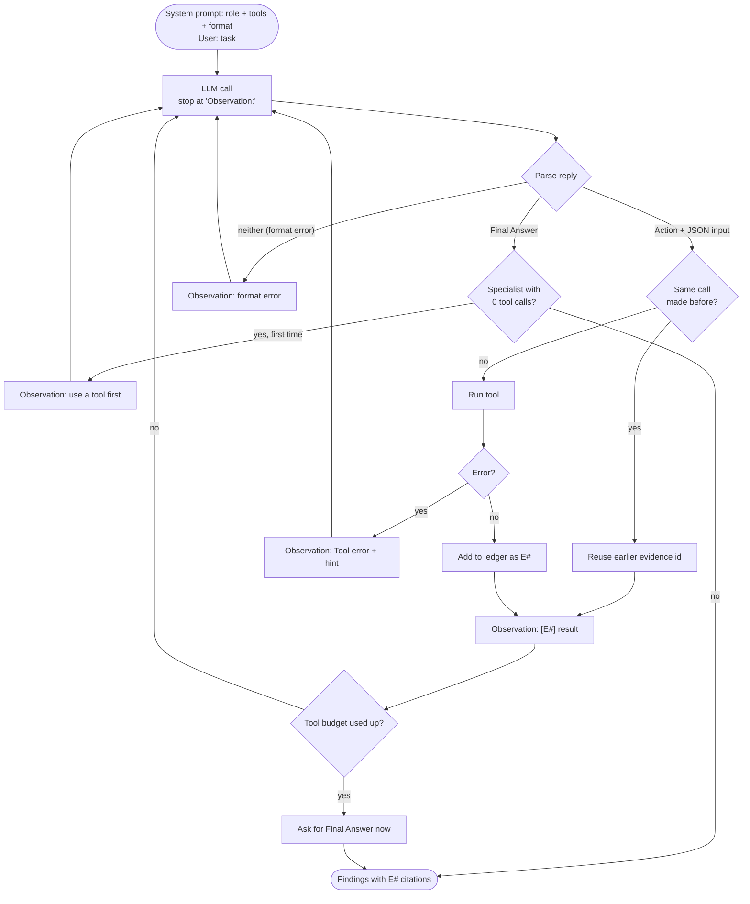

# ORCA-Prompt diagrams

All diagrams describe the code in `code/orca/` as built. Prompt IDs (P1–P6) match `prompts/final/`.

## 1. Prompt workflow

## 2. Task decomposition (example: T01)

## 3. Input–output flow

## 4. System architecture

## 5. Agent loop (ReAct, used by P1 and P2)

